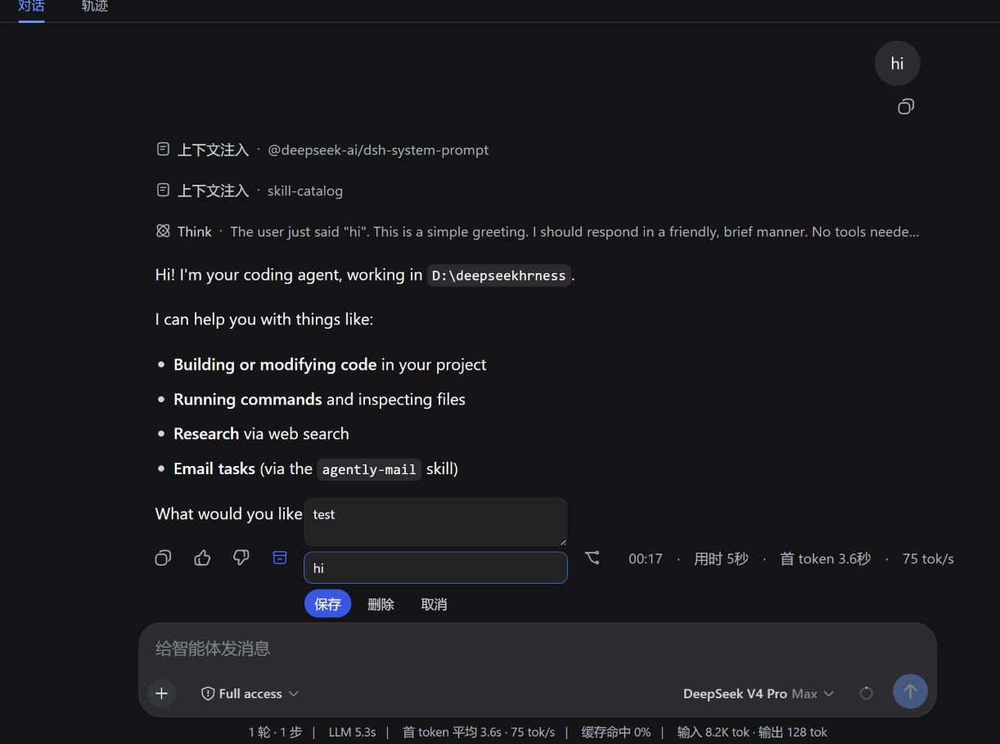
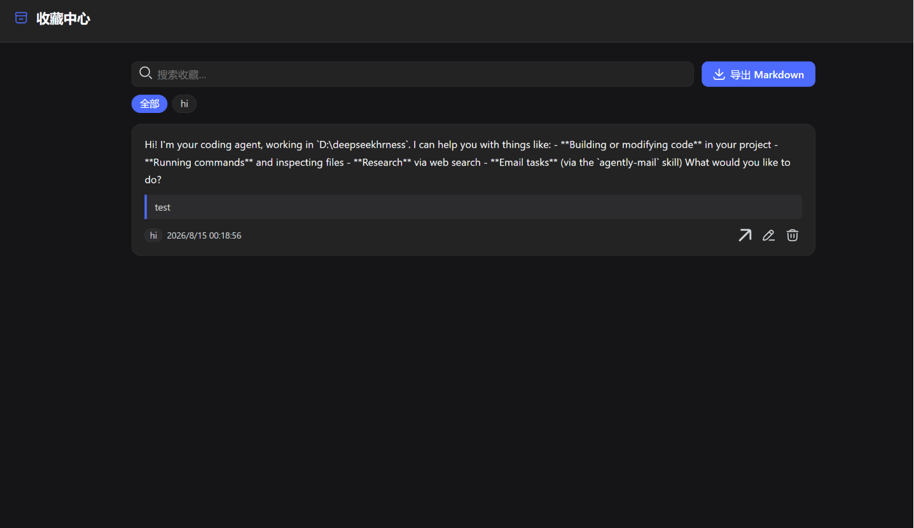

# dsh-bookmarks

[](https://awesome-dsh-plugin.com/) [](https://github.com/penguin-oo/dsh-bookmarks/actions/workflows/ci.yml)

给 [DeepSeek Harness](https://github.com/deepseek-ai/deepseek-harness)（DSH）Web 界面加「回复收藏夹」：收藏任意一条已完成的 AI 回复（可加备注和标签），在统一的收藏中心里跨会话浏览、搜索、筛选，一键导出 Markdown。

[English](./README.md)

## 截图





## 功能

- **逐条收藏** — 每条已定稿的 AI 回复旁边有一个归档按钮（就在 👍/👎 反馈按钮旁），点击收藏，并可内联编辑备注与逗号分隔的标签。
- **服务端摘要** — 收藏时宿主端自动从会话日志提取该回复的文本预览，不写备注也能在收藏中心里认出来。
- **跨会话收藏中心** — 一个面板汇集所有会话、所有工作区的收藏，支持全文搜索、标签筛选、内联编辑与删除。
- **一键跳回** — 直接定位到收藏的回复，必要时自动加载较早的历史。
- **导出 Markdown** — 一键下载全部收藏为 `dsh-bookmarks.md`。
- **快捷键** — 任意界面按 `Alt+B` 开关收藏中心。
- **安全写入** — 每条收藏带版本号做 compare-and-set（多标签页安全），服务端严格校验，经 DSH storage domain 持久化。

## 安装

```sh
dsh plugin --profile web add dsh-bookmarks
```

然后重启 DSH（`dsh web`）。插件会自动加入 profile 的 bundle 层，无需其他配置。

本地开发目录安装：

```sh
# 在插件仓库目录里执行（相对路径会锚定到当前目录）
dsh plugin --profile web add file:./
```

## 配置

bundle 行暴露三个可选上限：

| 键 | 默认 | 含义 |
|---|---|---|
| `maxNoteBytes` | `4096` | 单条备注的最大 UTF-8 字节数（`""` 清除备注；省略该字段则保留原值）。 |
| `maxSnippetChars` | `300` | 服务端摘要的最大字符数。 |
| `maxTags` | `8` | 每条收藏的标签上限；单个标签 ≤ 32 字符，自动去空白与去重。 |

在 profile 补丁层（`$DSH_HOME/profiles/web/cordis.patch.yml`）覆盖：

```yaml
- id: bookmarks
  config:
    maxNoteBytes: 2048
    maxSnippetChars: 200
    maxTags: 5
```

## 原理

一个 npm 包承载插件的两个半边：

- **宿主半边**（`lib/index.js`）— `bookmarks` Remote 服务（Typert），数据存于 storage-domain（`$DSH_HOME/storages/bookmarks.json`）。`put` 会读取持久化的会话日志，校验目标回复真实存在并提取摘要，复刻官方 `message-feedback` 的持久性屏障，所有写入按版本号串行 + 冲突对账。
- **浏览器半边**（`src/client`，构建为 `lib/client.js`）— 通过 `ctx.remote.$mount` 挂载 Remote 描述符，再注册两个 UI 槽位：`conversation.chat.assistant-actions`（逐条收藏按钮）与 `sidebar.footer.action`（收藏中心入口）。

## 开发

```sh
npm install            # zod + esbuild（仅开发）
npm run build          # 将 src/client 打包为 lib/client.js
npm test               # Remote 清单校验及收藏读写回归测试
```

`lib/client.js` 随包发布，安装时无构建步骤。

### DSH 0.2.1 适配

DSH 0.2.1 的会话持久化改用 `stat/open` 和只读 handle，移除了旧的
`listSnapshots/inspect/readFrom` 接口。旧插件在收藏时调用这些接口会抛出
`TypeError`，最终显示为 `gateway/internal`。本版本自动选择新旧接口，读取后
关闭 handle，并在收藏当前会话时先刷新日志、核验持久化前缀，再写入收藏。
基础设施错误也会显示具体消息，方便排查。

### 桌面端布局

回复旁的备注与标签编辑使用 DSH 原生弹窗，避免挤压或被操作栏裁切。
收藏中心独立挂载到页面顶层，并避开 macOS 窗口按钮与 Windows 标题栏；
同时兼容 Claude 风格主题对普通对话框的尺寸限制。窄窗口中搜索和导出按钮自动换行。

## 已知限制

- 收藏存于单个全局行：个人使用完全够用，但不是多用户共享存储。
- 中心入口在侧栏底部；侧栏收起时用 `Alt+B`。

## License

[MIT](./LICENSE)

## 致谢

本项目在 [LINUX DO](https://linux.do) 社区推广。

